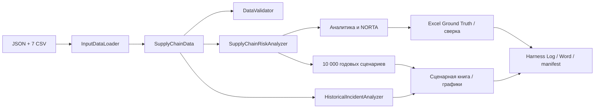

# Архитектура расчёта

`models.py` содержит неизменяемые `@dataclass` для узлов, финансов, распределений, затрат, матриц, инцидентов, сценариев и результатов. Этот выбор обеспечивает типизированные границы без дополнительной библиотеки и не превращает DataFrame в глобальное состояние. `loaders.py` читает CSV с `utf-8-sig`, строго нормализует сокращения ID на строках и столбцах матриц. `validators.py` проверяет диапазоны, согласованность CSV/JSON, единицы, спектр и границы Фреше. `analytics.py` содержит чистые формулы. `simulation.py` строит бинарные состояния цепи, логнормальные/паретовские простои и убытки; калибрует NORTA. `historical.py` отдельно анализирует эмпирические данные. `artifacts.py` строит документы и графики. `orchestrator.py` связывает этапы 1–10.

Мастер JSON содержит топологию, 6 узлов, финансовые параметры, распределения и матрицы. `InputDataLoader` сопоставляет его с CSV и формирует `SupplyChainData`. `SupplyChainRiskAnalyzer` принимает этот объект и берёт из него все вероятности, стоимости и параметры простоя; резервный HF исключён из S0 и включается только в сценариях с дуал-сорсингом. Стресс `R_PGM=0.80` введён исключительно для S3/S4 по заданию, с сохранением остальных исходных надёжностей.

Контракт `SupplyChainRiskAnalyzer.analytic_independent(dual, rho, stress)` возвращает `R_sys`, `P_fail`, `EL`, `EL_med`; `simulate(kind, seed, duration)` возвращает массивы годовых состояний, длительностей и убытков. `joint_failure_probability` отклоняет корреляции за границами Фреше. `cvar` усредняет ровно худшую долю `1−α`, включая дробный вес на пороге. `simulate_copula` трактует CSV как целевые **бинарные** корреляции, решает пару двумерной нормальной CDF численно и проверяет PSD итоговой латентной матрицы. Парная формула HF не применяется ко всей шестимерной системе.

Аналитический эталон: `R_sys=∏R_i`, `P_fail=1−R_sys`, `median(T)=exp(μ)`, `E[T]=exp(μ+σ²/2)`, `EL=P_fail(C_day·E[T]+C_scrap)`. Резерв: `R_HF=1−Q_aQ_b−ρ√(R_aQ_aR_bQ_b)`, `TCO=CAPEX·r_amor+audit+procurement`, `ROI=(ΔEL−TCO)/TCO`. Денежные величины — млн USD, длительности — дни, потери — млн USD за годовой сценарий. Источники формул: лекция 5 ЭА, слайды 7–10, 17–25, 29–34; задание 3, с. 2–4.

Сверка отделяет детерминированные расхождения от ошибки Монте-Карло: для `R_sys` используется биномиальная SE, для логнормального `EL` выборочная SE; допуск задан как 4×SE. У Парето с `alpha=1.3` конечное среднее, но бесконечная теоретическая дисперсия, поэтому нормальные доверительные интервалы для среднего не интерпретируются. `VaR/CVaR99` при N=10000 опирается на 100 худших опытов и чувствителен к seed.

Исторический анализ: Shapiro–Wilk на log(T), KS для заданной априорной логнормальной модели, параметрический бутстреп для KS после подгонки параметров. Остатки `Direct_Loss−(C_day·Downtime+C_scrap)` сохраняются без исправления первичных данных. Номер года в `Incident_ID` не отождествляется с датой без подтверждённого правила кодирования.
