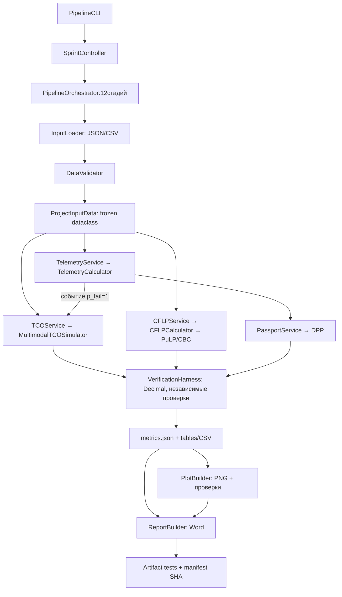

# Архитектура практической работы4

`interface.py` только разбирает параметры; `controller.py` передаёт запуск оркестратору. `loaders.py` единолично парсит источники. `validators.py` отделяет пригодность данных от достоверных инцидентов. До входа в сервисы проверяется типизированный агрегатор. `models.py` не выполняет IO и вычисления. Математика сосредоточена в `calculators/`. Сервисы получают калькуляторы через конструкторы; не рисуют. Аналитические тексты готовятся в `analysis.py`; Word получает сохранённые результаты и не решает задачи заново. `plotting.py` читает экспортированные CSV, а не скрытое состояние.

Изменяемое состояние ограничено `MultimodalTCOSimulator.probabilities`: исходные объекты неизменны, ссылка Rail_Express сохраняется. Модуль3 вызывает тот же экземпляр; исходный TCO frozen и сохранён до обновления.

Вместо четырёх небольших файлов сервисы размещены в одном `src/services.py`: четыре класса и явные зависимости без пустых модулей. Haversine находится рядом с телеметрией. Управление журналами размещено в оркестраторе и Harness; дублирующий logger_config не нужен.

`execution.log` — процесс с run_id/стадией/traceback; HARNESS_LOG CSV/MD — append-only история сравнений и исправлений. В манифесте текущий статус отделён от исторических неудачных попыток разработки. Критические ошибки прекращают зависимые расчёты и сохраняют FAIL-манифест, не позволяя выдать невалидные цифры за результат.
